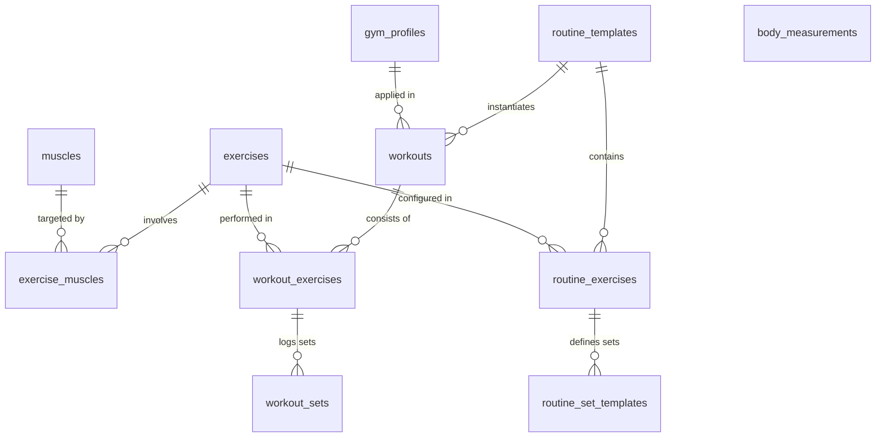

# System- & Datenmodell-Architektur: Gym-Tracker (Offline-First)

## 1. Übersicht & Leitprinzipien

Die Gym-Tracker-App ist eine 100% kostenlose, lokale **Offline-First** Progressive Web App (PWA), optimiert für Android / Samsung Smartphones sowie Desktop-Browser.

### Kern-Architekturprinzipien
1. **Zero Cloud Requirement (100% Offline-First):**
   Alle Daten liegen primär in der lokalen Browser-IndexedDB via **Dexie.js**. Kein zwingender Server, keine Registrierungspflicht, volle Privatsphäre und sofortige Latenzfreiheit (<16ms Interaction-to-Next-Paint).
2. **Deterministic & Strict Typing:**
   TypeScript im Strict-Mode garantiert Datenintegrität über alle Tabellen, Relationen und State-Transitions hinweg.
3. **Headless & Service-Oriented (Schritt 1):**
   Die Datenmodelle, Seed-Datenbanken und Rechenkerne (z.B. Effective Weight, Plate Math, Progression) sind vollständig entkoppelt von UI-Frameworks und können autonom via **Vitest** mit `fake-indexeddb` getestet werden.
4. **Studio-spezifische Physik (gym80 & McFit Realität):**
   Berücksichtigung realer Flaschenzug-Übersetzungen (Pulley Ratios), 2.5-kg-Micro-Addons, vordefinierter Kurzhantel-Staffelungen und Schlitten-Eigengewichten von Plate-Loaded-Geräten.

---

## 2. Datenbank-Schema (Dexie.js / IndexedDB)

Alle Entitäten nutzen UUIDs als Primärschlüssel (`id`), außer anatomische Muskeln, die semantische Strings als Primärschlüssel nutzen (z.B. `'chest_upper'`). Jede Entität führt `created_at` und `updated_at` als ISO-8601-Strings.



### 2.1 Tabellen-Spezifikation

#### 1. `gym_profiles`
Speichert das Geräte-Setup und die Ausstattungs-Spezifika eines Fitnessstudios.
- `id`: `string` (UUID, Primary Key)
- `name`: `string` (z.B. "McFit Bruchsal (gym80)")
- `is_default`: `boolean`
- `available_plates_kg`: `number[]` (z.B. `[20, 15, 10, 5, 2.5, 1.25]`)
- `barbell_options_kg`: `number[]` (z.B. `[20, 15, 10]` für Olympia-, kurze und SZ-Stange)
- `dumbbell_list_kg`: `number[]` (z.B. `[1..10]` in 1-kg-Schritten, `[12..50]` in 2-kg-Schritten)
- `stack_increment_kg`: `number` (Standard-Blockabstufung, bei gym80 = `5.0`)
- `stack_micro_addon_kg`: `number` (Zuschaltbares Zusatzgewicht am Block, bei gym80 = `2.5`)
- `created_at`: `string` (ISO 8601)
- `updated_at`: `string` (ISO 8601)

#### 2. `muscles`
Anatomische Muskelkatalogisierung mit feingranularer Aufteilung (u.a. Schulterköpfe getrennt).
- `id`: `string` (PK, z.B. `'chest_upper'`, `'delts_side'`)
- `name_de`: `string` (z.B. "Seitliche Schulter")
- `muscle_group`: `string` (z.B. "Schultern", "Brust", "Rücken", "Arme", "Beine", "Core")
- `created_at`: `string`
- `updated_at`: `string`

#### 3. `exercises`
Zentraler Übungskatalog mit biomechanischen Geräteattributen und Bestmarken.
- `id`: `string` (UUID, Primary Key)
- `name`: `string` (Deutsche Bezeichnung)
- `tracking_type`: `'weight_reps' | 'bodyweight_reps' | 'assisted_bodyweight' | 'duration_seconds'`
- `equipment_type`: `'barbell' | 'dumbbell' | 'cable_stack' | 'machine_stack' | 'plate_loaded' | 'bodyweight'`
- `movement_type`: `'compound' | 'isolation'`
- `laterality`: `'bilateral' | 'unilateral'`
- `pulley_ratio`: `number` (Default: `1.0`. Übersetzungsverhältnis bei Kabelzügen; `0.5` bei 1:2 Flaschenzügen, `1.0` bei Direktzug)
- `default_bar_or_sled_weight_kg`: `number` (Default: `0`. Start-/Eigengewicht bei Schlitten oder Langhanteln)
- `bodyweight_factor`: `number` (Default: `0`. z.B. `1.0` bei Klimmzügen, `0.0` bei Bankdrücken)
- `pinned_setup_note`: `string` (Dauerhafte Notiz zur Geräteeinstellung, z.B. "Sitzhöhe 4, Hebel 2")
- `custom_rest_seconds`: `number | null` (Übungsspezifische Pause)
- `best_1rm`: `number | null`
- `best_10rm`: `number | null`
- `max_volume_set`: `number | null` (Maximales Satzvolumen: Gewicht * Wdh)
- `created_at`: `string`
- `updated_at`: `string`

#### 4. `exercise_muscles`
M:N-Verknüpfung zwischen Übungen und Muskeln inkl. Gewichtungsfaktor für Volumenberechnung.
- `id`: `string` (UUID, Primary Key)
- `exercise_id`: `string` (Foreign Key -> exercises.id)
- `muscle_id`: `string` (Foreign Key -> muscles.id)
- `role`: `'primary' | 'secondary' | 'tertiary'`
- `volume_weight`: `number` (`1.0` für Primär, `0.5` für Sekundär, `0.25` für Tertiär)
- `created_at`: `string`
- `updated_at`: `string`

#### 5. `routine_templates`
Trainingspläne / Workout-Vorlagen (z.B. "Push A", "Pull A", "Beine").
- `id`: `string` (UUID, Primary Key)
- `name`: `string`
- `split_category`: `string` (z.B. "Push/Pull/Legs", "Oberkörper/Unterkörper", "Ganzkörper")
- `order_index`: `number`
- `is_archived`: `boolean`
- `created_at`: `string`
- `updated_at`: `string`

#### 6. `routine_exercises`
Übungskonfiguration innerhalb einer Routine inklusive Progressionsregeln.
- `id`: `string` (UUID, Primary Key)
- `routine_id`: `string` (Foreign Key -> routine_templates.id)
- `exercise_id`: `string` (Foreign Key -> exercises.id)
- `order_index`: `number`
- `superset_group_id`: `number | null` (Gruppiert Übungen zu Supersätzen / Zirkeln)
- `rest_seconds`: `number` (Soll-Pausenzeit)
- `progression_rule`: `ProgressionRule` (JSON-Objekt):
  ```typescript
  {
    type: 'double_progression' | 'linear' | 'none';
    rep_range: [number, number]; // z.B. [8, 12]
    target_rir: number;          // z.B. 1 oder 2
    deload_after_fails: number;  // z.B. 3 Stagnations-Sessions
  }
  ```
- `created_at`: `string`
- `updated_at`: `string`

#### 7. `routine_set_templates`
Satz-Templates innerhalb einer Routine-Übung.
- `id`: `string` (UUID, Primary Key)
- `routine_exercise_id`: `string` (Foreign Key -> routine_exercises.id)
- `set_index`: `number` (0, 1, 2...)
- `set_type`: `'warmup' | 'working' | 'drop'`
- `target_reps_min`: `number`
- `target_reps_max`: `number`
- `target_weight_stack`: `number | null` (Soll-Gewicht auf dem Gerätesteckblock bzw. Hantel)
- `target_rir`: `number | null` (Reps in Reserve Zielwert)
- `created_at`: `string`
- `updated_at`: `string`

#### 8. `workouts`
Durchgeführte oder laufende Trainingseinheiten.
- `id`: `string` (UUID, Primary Key)
- `routine_id`: `string | null` (Optional Verknüpfung zur Vorlage)
- `gym_profile_id`: `string` (Foreign Key -> gym_profiles.id)
- `title`: `string`
- `top_note`: `string`
- `started_at`: `string | null` (ISO 8601)
- `finished_at`: `string | null` (ISO 8601)
- `is_deload_session`: `boolean`
- `created_at`: `string`
- `updated_at`: `string`

#### 9. `workout_exercises`
Im Workout ausgeführte Übungen.
- `id`: `string` (UUID, Primary Key)
- `workout_id`: `string` (Foreign Key -> workouts.id)
- `exercise_id`: `string` (Foreign Key -> exercises.id)
- `order_index`: `number`
- `superset_group_id`: `number | null`
- `session_note`: `string`
- `pause_progression`: `boolean` (Default: `false` - Schutz vor Progressions-Strafen bei schlechter Tagesform/Reha)
- `created_at`: `string`
- `updated_at`: `string`

#### 10. `workout_sets`
Tatsächlich absolvierte Sätze mit erfassten Ist-Werten und berechnetem effektiven Gewicht.
- `id`: `string` (UUID, Primary Key)
- `workout_exercise_id`: `string` (Foreign Key -> workout_exercises.id)
- `set_number`: `number`
- `side`: `'both' | 'left' | 'right'` (Unterstützt Unilateral-Tracking)
- `set_type`: `'warmup' | 'working' | 'drop' | 'failure'`
- `target_weight_snapshot`: `number | null`
- `target_reps_min_snapshot`: `number | null`
- `target_reps_max_snapshot`: `number | null`
- `target_rir_snapshot`: `number | null`
- `actual_weight`: `number | null` (Gestecktes/abgelesenes Gewicht auf dem Gerät oder der Hantel)
- `effective_weight_kg`: `number | null` (Automatisch berechnetes Reallast-Gewicht)
- `actual_reps`: `number | null`
- `actual_rir`: `number | null`
- `used_micro_addon`: `boolean` (Default: `false` - Kennzeichnet Zuschaltung des 2,5kg gym80 Addons)
- `is_completed`: `boolean`
- `completed_at`: `string | null`
- `pr_flags`: `string[]` (z.B. `['PR_WEIGHT', 'PR_REPS', 'PR_VOLUME']`)
- `created_at`: `string`
- `updated_at`: `string`

#### 11. `body_measurements`
Tracking von Körpergewicht und KFA.
- `id`: `string` (UUID, Primary Key)
- `recorded_at`: `string` (Format: `YYYY-MM-DD`)
- `bodyweight_kg`: `number`
- `bodyfat_pct`: `number | null`
- `notes`: `string | null`
- `created_at`: `string`
- `updated_at`: `string`

---

## 3. McFit- & gym80-Studio-Regeln & Physik

### 3.1 Seilzug-Übersetzungen (Pulley Ratio)
Viele Fitness-Apps scheitern daran, dass 50 kg an einem Kabelzug nicht gleich 50 kg an einem anderen sind.
- **Frei verstellbarer gym80 Doppel-Kabelzug (Cable Tower / Freemotion / Crossover):**
  - Physik: 1:2 Flaschenzug (`pulley_ratio = 0.5`).
  - Gesteckt: 50 kg -> Tatsächliche Zugkraft am Handgriff: $50 \times 0.5 = 25.0\text{ kg}$.
  - Gesteckt mit 2,5 kg Micro-Addon: $(50 + 2.5) \times 0.5 = 26.25\text{ kg}$.
- **gym80 Latzug-Turm & gym80 Sitzendes Rudern:**
  - Physik: 1:1 Direktzug (`pulley_ratio = 1.0`).
  - Gesteckt: 70 kg -> Tatsächliche Zugkraft am Griff: $70 \times 1.0 = 70.0\text{ kg}$.
- **gym80 Steckgewicht-Maschinen (Chest Press, Leg Extension etc.):**
  - Physik: Intern über Hebelarme kalibriert, `pulley_ratio = 1.0`.

### 3.2 Gewichtsabstufungen & Micro-Loading (gym80 Standard)
- **Gewichtsblöcke (Stack Increment):**
  - Feste 5.0-kg-Schritte (z.B. 5, 10, 15, 20 ... 100 kg).
- **gym80 Micro-Addon:**
  - Zuschaltbares oder auflegbares 2.5-kg-Zusatzgewicht am Block.
  - Ermöglicht Zwischenschritte: 50.0 kg -> +Addon -> 52.5 kg -> nächster Block 55.0 kg.
- **Kurzhantelsatz McFit:**
  - `[1, 2, 3, 4, 5, 6, 7, 8, 9, 10]` kg in 1-kg-Schritten.
  - `[12, 14, 16, 18, 20, 22, 24, 26, 28, 30, 32, 34, 36, 38, 40, 42, 44, 46, 48, 50]` kg in 2-kg-Schritten.
- **Hantelscheiben McFit:**
  - Standard-Guss/Gummi-Scheiben: `[20, 15, 10, 5, 2.5, 1.25]` kg.
  - Kleinster bilateraler Scheibenschritt (auf beiden Seiten 1.25 kg): $+2.5\text{ kg}$.
- **Stangen McFit:**
  - Olympia-Langhantel: `20 kg`
  - Kurze Langhantel: `15 kg`
  - SZ-Curlstange: `10 kg`
- **Plate-Loaded Eigengewichte (gym80 Pure Kraft):**
  - gym80 45° Beinpresse Schlittengewicht: `50 kg` (Default-Eigengewicht)
  - gym80 Pure Kraft Hebelarme: Kalibriertes Startgewicht (z.B. je nach Gerät 15 - 20 kg).

### 3.3 Formel zur Berechnung des `effective_weight_kg`

```typescript
export function calculateEffectiveWeight(params: {
  equipmentType: EquipmentType;
  trackingType: TrackingType;
  actualWeight: number | null;
  usedMicroAddon: boolean;
  microAddonKg: number;
  pulleyRatio: number;
  defaultBarOrSledWeightKg: number;
  userBodyweightKg?: number | null;
  bodyweightFactor?: number;
}): number | null {
  const {
    equipmentType,
    trackingType,
    actualWeight,
    usedMicroAddon,
    microAddonKg,
    pulleyRatio,
    defaultBarOrSledWeightKg,
    userBodyweightKg = 0,
    bodyweightFactor = 0,
  } = params;

  if (trackingType === 'bodyweight_reps') {
    const bwPortion = (userBodyweightKg ?? 0) * bodyweightFactor;
    return (actualWeight ?? 0) + bwPortion;
  }

  if (trackingType === 'assisted_bodyweight') {
    const bwPortion = (userBodyweightKg ?? 0) * bodyweightFactor;
    return Math.max(0, bwPortion - (actualWeight ?? 0));
  }

  if (actualWeight === null || actualWeight === undefined) {
    return null;
  }

  switch (equipmentType) {
    case 'cable_stack': {
      const addon = usedMicroAddon ? microAddonKg : 0;
      return (actualWeight + addon) * (pulleyRatio || 1.0);
    }
    case 'machine_stack': {
      const addon = usedMicroAddon ? microAddonKg : 0;
      return actualWeight + addon;
    }
    case 'plate_loaded':
    case 'barbell': {
      return actualWeight + (defaultBarOrSledWeightKg || 0);
    }
    case 'dumbbell':
    case 'bodyweight':
    default:
      return actualWeight;
  }
}
```

---

## 4. Progressions- & Sicherungslogik

1. **Double Progression (Standard für Hypertrophie):**
   - Übung hat Zielbereich, z.B. 3 Sätze à 8–12 Wdh.
   - Gewicht bleibt fix, bis im letzten Arbeitssatz die Obergrenze (12 Wdh) bei RIR $\ge \text{target\_rir}$ erreicht wird.
   - Erst dann empfiehlt das System die kleinste Steigerung gemäß `gym_profiles` (z.B. +2.5 kg Hanteln / Scheiben oder +2.5 kg Micro-Addon am gym80-Block).
2. **Recovery-Schutz (`pause_progression = true`):**
   - Wenn der Nutzer z.B. angeschlagen trainiert, kann pro Übung im Workout `pause_progression` aktiviert werden.
   - Schlechte Satzleistungen fließen dann nicht in Deload-Counter oder Progressionsabbrüche ein.

---

## 5. Indizierung & Performance in Dexie.js

Für Offline-First-Performance auf Mobilgeräten werden sekundäre Indizes auf häufig abgefragte Relationen gelegt:
- `workouts`: `started_at`, `finished_at`, `routine_id`, `gym_profile_id`
- `workout_exercises`: `workout_id`, `exercise_id`
- `workout_sets`: `workout_exercise_id`, `is_completed`
- `exercises`: `name`, `equipment_type`, `movement_type`
- `exercise_muscles`: `exercise_id`, `muscle_id`
- `body_measurements`: `recorded_at`

---

## 6. Services & Business-Logic

### 6.1 `Gym80EquipmentService`
Zuständig für alle studiorelevanten Berechnungen:
1. `calculateEffectiveLoad(enteredWeightKg, exercise, bodyweightKg)`:
   - `cable_stack` / `machine_stack`: $enteredWeight \times exercise.pulley\_ratio$
   - `bodyweight_reps`: $(bodyweightKg \times exercise.bodyweight\_factor) + enteredWeightKg$
   - `assisted_bodyweight`: $\max(0, (bodyweightKg \times exercise.bodyweight\_factor) - enteredWeightKg)$
   - `barbell` / `dumbbell` / `plate_loaded`: $enteredWeightKg$
2. `getNextAvailableWeight(currentEnteredWeightKg, exercise, gymProfile, direction)`:
   - `dumbbell`: Nutzt exakte Kurzhantelstaffelung (ab 10 kg in 2-kg-Schritten, z.B. 20 -> 22 kg).
   - `cable_stack` (1:2 Flaschenzug):
     - Isolationsübungen: 2,5-kg-Blockschritte (mit 2,5-kg-Zusatzgewicht, real +1,25 kg Reallast).
     - Verbundübungen: 5,0-kg-Blockschritte (real +2,5 kg Reallast).
   - `cable_stack` (1:1 Latzug/Rudern) & `machine_stack`:
     - 2,5-kg-Schritte (mittels gym80 Micro-Addon).
   - `barbell` & `plate_loaded`:
     - 2,5-kg-Schritte (2x 1,25 kg kleinste Scheiben).
3. `calculatePlatesPerSide(targetTotalWeightKg, barWeightKg, availablePlatesKg)`:
   - Ermittelt gierig (Greedy) die exakt benötigten Hantelscheiben pro Seite.
4. `calculateDropSetWeight(workingWeightKg, exercise, gymProfile)`:
   - Automatische Reduktion um 20-25 % bzw. 2 Platten am gym80 Steckblock.

### 6.2 `ProgressionEngine`
Zuständig für Satz-Sollwerte (`target_weight_snapshot`, `target_reps_min_snapshot`, `target_reps_max_snapshot`, `target_rir_snapshot`):
1. **Tagesform- & Recovery-Schutz:**
   Filtert automatisch Einheiten mit `pause_progression === true` oder `is_deload_session === true` heraus, sodass schlechte Form oder Reha-Tage den Trainingsfortschritt nicht bestrafen.
2. **Double Progression Regel:**
   - Wenn in allen Arbeitssätzen die obere Rep-Grenze (`rep_range[1]`) bei $\text{actual\_rir} \ge \text{target\_rir}$ erreicht wurde:
     - Gewicht wird über `getNextAvailableWeight('up')` gesteigert.
     - Wiederholungsziel wird auf die Untergrenze `rep_range[0]` (z.B. 8 Wdh.) zurückgesetzt.
   - Andernfalls:
     - Gewicht bleibt gleich.
     - Wiederholungsziel liegt bei $+1$ Rep über der im letzten Training geschafften Leistung (gedeckelt auf `rep_range[1]`).
3. **Dropset-Automatik:**
   Drop-Sätze erhalten automatisch ein 20-25 % reduziertes Gewicht und ein Ziel-RIR von 0 (Muskelversagen).

---

## 7. Lifecycle, Analytics & Backup/Import Services

### 7.1 `WorkoutLifecycleService`
Verwaltet den Trainingsablauf von Start bis Abschluss:
- `startWorkout(routineId, gymProfileId?)`: Erstellt Workout; `started_at` bleibt `null` bis zum ersten abgehakten Satz; expandiert `unilateral`-Übungen automatisch in `left`- und `right`-Sätze; initialisiert Ziel-Snapshots via `ProgressionEngine`.
- `completeSet(setId, input, bodyweightKg?)`: Berechnet `effective_weight_kg`; wahrt strikte Trennung von Soll-Snapshot und Ist-Werten; erkennt PRs (`PR_WEIGHT`, `PR_REPS`, `PR_VOLUME_SET`, `PR_E1RM`, `PR_E10RM`) und aktualisiert Übungs-Rekorde (`best_1rm`, `best_10rm`, `max_volume_set`).
- `getRestTimerInfo(workoutId, lastCompletedSetId, currentTime?)`: Liefert empfohlene Countdown-Pause (`custom_rest_seconds` > `routine_exercise.rest_seconds` > Typ-Default 180s Compound / 90s Isolation) und berechnet `timeSinceLastSetSeconds` und `remainingCountdownSeconds`.
- `finishWorkout(workoutId)`: Setzt `finished_at`.

### 7.2 `AnalyticsService`
Offline-Analysen auf Basis der IndexedDB:
- `getWeeklyMuscleVolume(startDate, endDate, mode)`: Berechnet das wöchentliche Satzvolumen (nur Arbeitssätze) pro Muskelgruppe:
  - `mode: 'direct'`: Zählt nur Primärmuskeln (1.0).
  - `mode: 'fractional'`: Gewichtet Primär (1.0), Sekundär (0.5) und Tertiär (0.25).
- `getExerciseHistoryChart(exerciseId, metric)`: Liefert kalenderproportionale Zeitreihendaten für `e1rm`, `e10rm`, `stack_weight` oder `effective_weight`.

### 7.3 `BackupImportService`
100%ige Datensicherheit auf Mobilgeräten:
- `parseLocalizedNumber(input)`: Robuste Konvertierung deutscher Dezimalkommas (`"27,5"` -> `27.5`).
- `exportFullDatabaseJson()` / `importFullDatabaseJson(jsonString)`: 1-Klick Komplett-Backup und atomarer Restore aller 11 Tabellen.
- `importFromCsv(csvText, gymProfileId)`: Universeller Importer für Strong-, Hevy- und FitNotes-CSV-Dateien inklusive deutscher Spaltennamen und automatischer Übungsanlage.

---

## 8. Mobile-First Dark-Mode Frontend & PWA (Schritt 4)

### 8.1 Ergonomie & Gym-Floor UX-Design
- **OLED Black Theme (`#000000`):** Reines Schwarz für maximale Energieersparnis und Pixel-Schärfe auf Samsung AMOLED-Screens im grellen Studiolicht.
- **Gym-Floor Touch Targets:** Alle interaktiven Flächen besitzen eine Mindesthöhe von **48px** bis **56px** für ermüdete oder verschwitzte Hände zwischen harten Arbeitssätzen.
- **Viewport & Notch-Awareness:** Mobile Meta-Tags (`viewport-fit=cover`, `user-scalable=no`) und CSS-Umgebungsvariablen (`env(safe-area-inset-bottom)`) verhindern versehentliches Zoomen und Kollisionen mit Android-Navigationsleisten.
- **PWA Standalone Mode:** `manifest.json` und Service Worker (`sw.js`) erlauben das Hinzufügen der App zum Android-Homescreen als vollwertige native App ohne Browserleisten.

### 8.2 Komponenten-Architektur

```
src/
├── App.tsx                     # Root-Orchestrierung, Bottom-Navigation & Minimiert-Bar
├── main.tsx                    # React 19 Entrypoint
├── index.css                   # Dark-OLED CSS, Utility-Styles & Animationen
├── components/
│   ├── WorkoutScreen.tsx       # Herzstück: Aktives Training, Satzprotokollierung & PRs
│   ├── GymKeypad.tsx           # Custom Gym-Nummernblock mit McFit-Schrittweiten & Flow-Button
│   ├── RestTimerBar.tsx        # Live-Ruhetimer (+/-15s) & Zeit-seit-letztem-Satz-Stoppuhr
│   ├── PlateCalculatorModal.tsx # Scheibenrechner mit visueller Hantelstange
│   └── tabs/
│       ├── TrainingTab.tsx     # Workout-Übersicht, Vorlagen (Push/Pull/Legs), Freies Training
│       ├── ExercisesTab.tsx    # Übungskatalog mit Suchfilter & Notiz-Schnellbearbeitung
│       ├── AnalyticsTab.tsx    # Wöchentliches Muskelvolumen (Direkt/Fraktional) & Progression-Chart
│       └── ProfileTab.tsx      # Körpergewicht-Log, JSON-Export/Import & Strong/Hevy CSV-Import
```

### 8.3 Schlüssel-Features des Active Workout Screens
1. **Header & Live-Pacing:**
   - Editierbare globale Notiz (`top_note`).
   - Trainingsstoppuhr kombiniert mit `RestTimerBar`: Countdown-Timer für den aktuellen Satzwechsel (+15s / -15s Schnelltasten) und permanente Anzeige *"Zeit seit letztem Satz: MM:SS"*.
2. **Geräte-Intelligenz pro Übung:**
   - **Pinned Setup Note:** 1-Tap Bearbeitung der Sitz-/Polstereinstellung (z.B. *"Sitz 4, Polster 2"*).
   - **Tagesform-Toggle:** Ein-Klick Freeze der Progression für die aktuelle Einheit bei schlechtem Schlaf oder Übermüdung.
   - **Scheibenrechner-Popup:** 1-Tap Rechner für Langhantel- und Plate-Loaded-Übungen zur schnellen visuellen Bestückung der Stange.
   - **Übersetzungs-Badge & Micro-Addon:** Anzeige der Seilzug-Übersetzung (`1:2 Turm` vs. `1:1 Zug`) und `+2.5 kg` Gym80-Schnellzuschaltung.
3. **Satz-Erfassung & Custom Gym Keypad:**
   - Satzzeilen mit Typ (`W`, `1/2/3`, `D`, `F`), letzter Leistung und **"Heutiges Ziel"** (z.B. `40 kg × 10 Wdh. @ 2 RIR`).
   - Angedocktes Gym-Keypad mit deutschem Komma (`,`), Schnelltasten (`-2.5 / +2.5` bzw. `-2 / +2` bei Kurzhanteln, `-1 / +1`) und dem **"Weiter / Satz abhaken"**-Flow-Button.
   - Sofortige optische Hervorhebung von Rekorden (PR für Gewicht, Wdh., Satzvolumen, e1RM, e10RM) mit goldenen Abzeichen.


